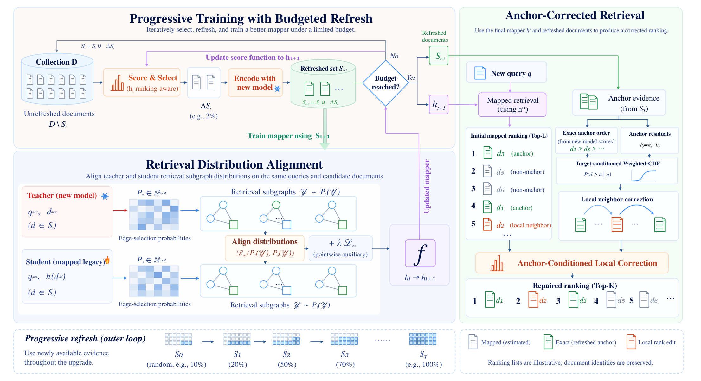

# Rankfill

Code for **Beyond Embedding Alignment: Retrieval-Oriented Progressive Backfilling for Vector Databases**, submitted to **The Web Conference (WWW)**.

[](assets/framework.pdf)

*Overview of Rankfill. Click the figure for the vector PDF. Budget labels in the illustration are schematic; the reproduction protocol is specified below.*

Rankfill recovers the rankings of an upgraded retriever while refreshing only a fraction of the document embeddings. It combines:

- **Retrieval Distribution Alignment (RDA):** train an old-to-new residual mapper using query-conditioned ranking distributions and cosine alignment.
- **RankImpact:** progressively refresh documents with high query exposure near the retrieval cutoff.
- **Anchor Ranking Correction (ARC):** use refreshed candidates to estimate comparison probabilities and correct rankings with an acyclic graph decoder.

This minimal release includes the complete Rankfill pipeline, encoder preparation, and tests. Baseline implementations, datasets, checkpoints, experiment logs, and ablation launchers are excluded.

## Installation

Use Python 3.10 and run commands from this repository's root.

```bash
python -m venv .venv
source .venv/bin/activate
python -m pip install --upgrade pip
python -m pip install -r requirements.txt
```

The pinned versions match the source experiment environment. Full MS MARCO runs require CUDA. Exact search materializes the full FP32 document gallery on one GPU: the gallery alone occupies about **25.3 GiB for Contriever** or **33.7 GiB for GTE**. Allow additional memory for query scores and intermediate tensors; a 48–80 GB GPU, about 128 GB host RAM, and at least 100 GB free disk are practical planning estimates, not measured minimums. `--query-batch` controls retrieval batch memory. Encoding can use multiple GPUs.

The tests run on CPU and generate their own small synthetic inputs:

```bash
python -m pip install -r requirements-dev.txt
python -m pytest -q
```

## Data

Download MS MARCO through the public BEIR distribution:

- [Passages and queries](https://huggingface.co/datasets/BeIR/msmarco)
- [Training and development relevance judgments](https://huggingface.co/datasets/BeIR/msmarco-qrels)
- [MS MARCO project](https://microsoft.github.io/msmarco/)

```bash
python src/download_data.py
```

This creates:

```text
data/
  corpus.jsonl          # {"pid": "...", "text": "..."}, one passage per line
  queries.train.tsv     # qid<TAB>text
  queries.dev.tsv
  qrels.train.tsv       # qid<TAB>pid<TAB>score
  qrels.dev.tsv
```

The canonical experiment uses 8,841,823 passages, 502,939 training queries, and 6,980 development queries. Training queries are partitioned into 452,645 training/acquisition and 50,294 validation queries with split seed 42. Development queries and judgments never enter mapper training, acquisition, or ARC calibration.

## Reproduce the canonical experiment

### 1. Prepare the old and new encoders

The old encoder is [facebook/contriever](https://huggingface.co/facebook/contriever). The canonical new encoder, `phi_new_x1`, fine-tunes the same model on 1% of MS MARCO training queries. This encoder-training fraction is independent of the document-refresh budget.

```bash
python src/build_phi_old.py --backbone contriever

CUDA_VISIBLE_DEVICES=0 python src/finetune.py \
  --backbone contriever --frac 0.01 --epochs 2 \
  --batch 256 --lr 2e-5 --max_len 256 --seed 42
```

### 2. Encode passages and queries

```bash
python src/encode_corpus.py \
  --backbone contriever --which phi_old --gpus 0 --batch 1024

python src/encode_corpus.py \
  --backbone contriever --which phi_new_x1 --gpus 0 --batch 1024

python src/encode_qtrain.py \
  --backbone contriever --which phi_new_x1 --gpus 0 --batch 1024
```

Use `--gpus 0,1,2,3` for multi-GPU encoding, or reduce encoding batches to fit memory. Arrays and their passage/query ID lists are saved under `data/emb/contriever/`. Old and new passage arrays must have identical row order.

The offline experiment precomputes the full new corpus for evaluation. During training, teacher mining, and ARC, the pipeline reads new document vectors only for the current refreshed set **S**. RankImpact uses mapped old vectors. Full-new oracle retrieval happens after predictions are saved; precomputation is not a measured online refresh cost.

### 3. Run progressive training and evaluation

```bash
CUDA_VISIBLE_DEVICES=0 python -m rankfill.run \
  --emb-dir data/emb/contriever \
  --old-tag phi_old --new-tag phi_new_x1 \
  --seed 42 --out outputs/contriever_x1_s42 \
  --qrels data/qrels.dev.tsv
```

The command:

1. Samples a random **0.2%** seed set and trains its RDA mapper.
2. Extends the cumulative refresh set to **1%, 2%, 5%, and 10%** with RankImpact, retraining the mapper from scratch each round.
3. Fits ARC at the final 10% budget, chooses its checkpoint and threshold using held-out training queries, and evaluates the corrected development rankings.

Add `--evaluate-all` to fit and evaluate ARC at each reported budget. Use a fresh output directory for each run; the minimal runner deliberately refuses to overwrite an existing run and does not resume partial stages.

For the three-seed setting, keep the encoders fixed and repeat the command with seeds **42, 0, and 1**, using a separate `--out` for each seed.

### 4. Read the results

```text
outputs/contriever_x1_s42/
  config.json
  manifest.json                      # budgets, selected-set hashes, checkpoints, metrics
  seed/
  budget_0.01/
  budget_0.02/
  budget_0.05/
  budget_0.1/
    selected.npy                     # global passage row indices in S
    teacher_top32.npz
    rda/mapper.pt
    rda/history.json
    cache/                           # mapped candidates and S-only anchor scores
    arc/checkpoint_best.pt
    arc/query_split.npz
    evaluation/threshold.json
    evaluation/predictions.npz
    evaluation/oracle_top10.npy
    evaluation/per_query_metrics.npz
    evaluation/metrics.json
```

`alignment_recall@5/10` and `alignment_ndcg@5/10` use the **full-new top-K set as binary positives**, not relevance judgments. With `--qrels`, `qrels_recall@5/10` and `qrels_ndcg@5/10` additionally report judged retrieval. All JSON metrics are fractions in `[0, 1]`; multiply by 100 for percentages.

For reference, the submitted manuscript reports the following **three-seed mean** at 10% refresh for Contriever x1:

| Alignment Recall@5 | Alignment Recall@10 | Alignment NDCG@5 | Alignment NDCG@10 |
| ---: | ---: | ---: | ---: |
| 78.63 | 80.25 | 83.49 | 85.64 |

These are manuscript results, not results from a fresh run of this release. The release preserves the core method and training recipe but reorganizes the experimental code. The downloader sorts query IDs for deterministic fresh runs; the original downloader used unordered query sets. Regenerated query row order therefore changes the row-based validation split and acquisition sample relative to the archived experiment. Original embeddings, encoder checkpoints, and upstream model revision pins are not bundled, so bitwise reproduction of those numbers is not claimed.

## Other encoder updates

For Contriever x10/x50/x100, repeat fine-tuning with `--frac 0.10`, `0.50`, or `1.00`, encode the corresponding `phi_new_x10/x50/x100` tag, and pass that tag to `rankfill.run`. The old encoder remains fixed.

For the released GTE model pair, use the supplied native encoding contracts:

```bash
python src/encode_gte_pair.py --tag gte_large_v1 --gpu 0 --batch 256
python src/encode_gte_pair.py --tag gte_large_v15 --gpu 0 --batch 256

CUDA_VISIBLE_DEVICES=0 python -m rankfill.run \
  --emb-dir data/emb/gte-large \
  --old-tag gte_large_v1 --new-tag gte_large_v15 \
  --seed 42 --out outputs/gte_s42 --qrels data/qrels.dev.tsv
```

The encoder IDs are [thenlper/gte-large](https://huggingface.co/thenlper/gte-large) and [Alibaba-NLP/gte-large-en-v1.5](https://huggingface.co/Alibaba-NLP/gte-large-en-v1.5). The latter uses the model repository's custom code through `trust_remote_code=True`. The GTE preparation entry point is included; a full GTE rerun is not part of the release smoke test.

The paper's BEIR collections are available from the [BEIR dataset catalog](https://github.com/beir-cellar/beir#beers-available-datasets). Dedicated OOD/TREC evaluation, ablations, and the optional relevance-supervised extension are outside this minimal release.

## Default protocol

| Component | Setting |
| --- | --- |
| Mapper | Residual MLP, hidden width 2048, ReLU, no batch normalization |
| Residual scale | Trainable, initialized to 0.03 |
| RDA | Top-J union with J=32, temperature 0.05, cosine weight 2 |
| Mapper optimization | AdamW, peak LR 0.001, weight decay 0.0001, OneCycle, 10% warm-up |
| Mapper schedule | 10 epochs per round, document/query batch 256, final epoch |
| RankImpact | K=10, M=20, temperature 0.01, up to 120,000 training queries |
| ARC | Candidate depth 1000, logistic bandwidth 0.01, flip loss weight 0.2 |
| ARC optimization | Adam, LR 0.001, 5 epochs, query batch 256, held-out loss selection |
| ARC decoding | Rank radius 5, head depth 20, strict 85th-percentile threshold |

At 100% refresh, serving hands off directly to the fully new index. The minimal runner handles partial budgets below 100%; its full-new oracle provides the endpoint reference.

## Code layout

```text
rankfill/
  run.py               # progressive experiment entry point
  training.py          # selected-only teacher mining and RDA training
  mapper.py            # residual old-to-new mapper
  acquisition.py       # RankImpact and nested-set selection
  weighted_cdf.py       # ARC conditional residual model and masked episodes
  arc.py               # comparison proposals and constrained decoding
  evaluation.py        # cache construction, calibration, evaluation
  retrieval.py         # exact inner-product search
  graph.py             # cycle prevention and stable topological ordering
  losses.py, metrics.py, mining.py, budgeted_corpus.py, query_validation.py
src/                   # download, encoder training, and embedding preparation
scripts/train_arc.py   # ARC training entry point
tests/                 # budget isolation, ranking invariants, CPU pipeline smoke test
```

## Citation

The paper is currently submitted to WWW. Citation metadata and a public paper link will be added with the public manuscript.
